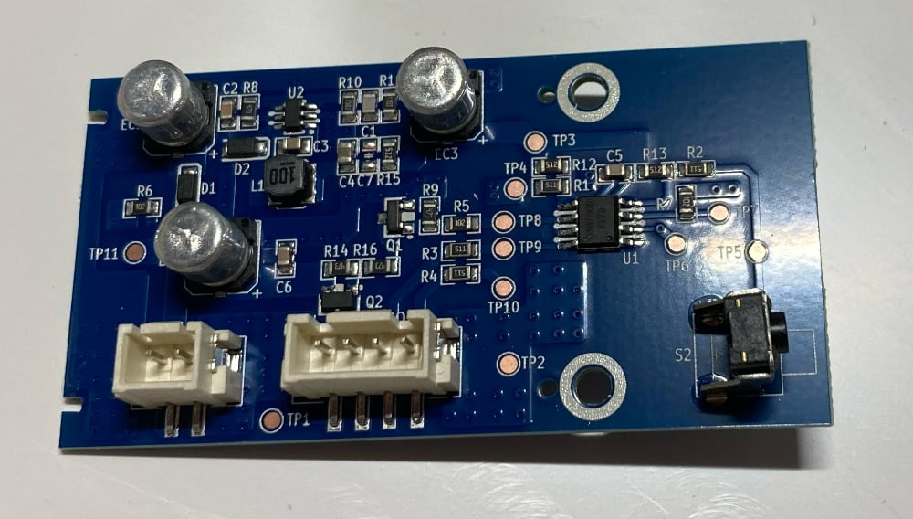
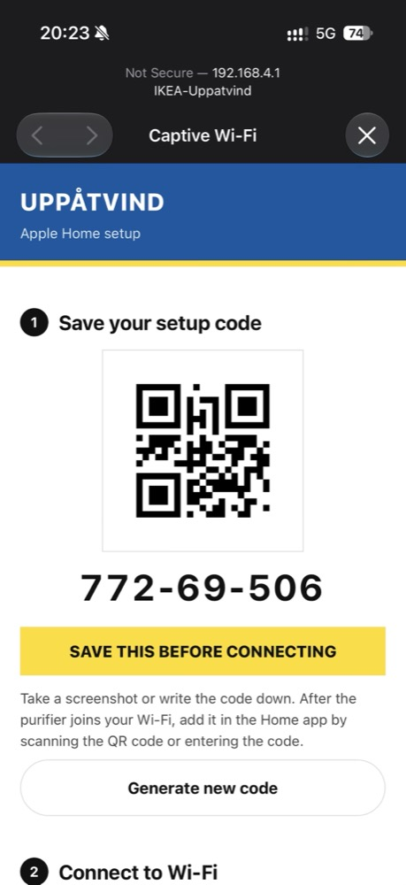
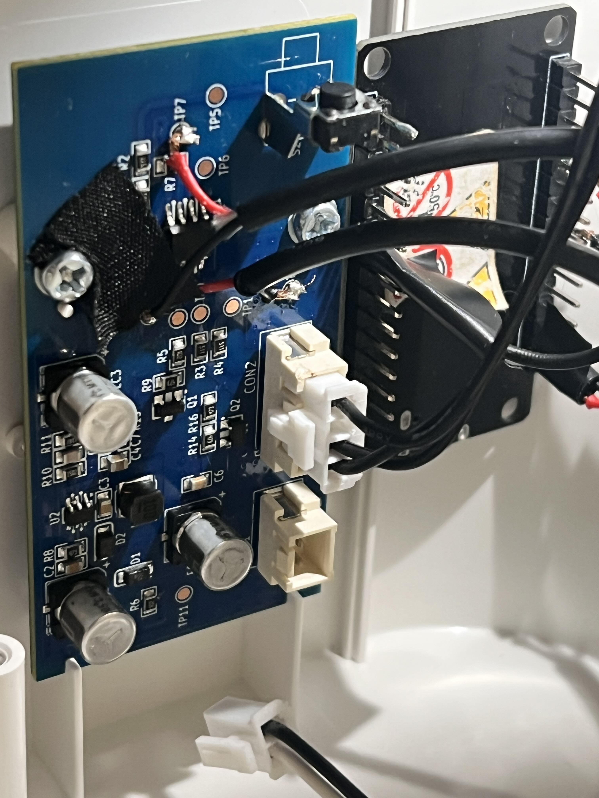
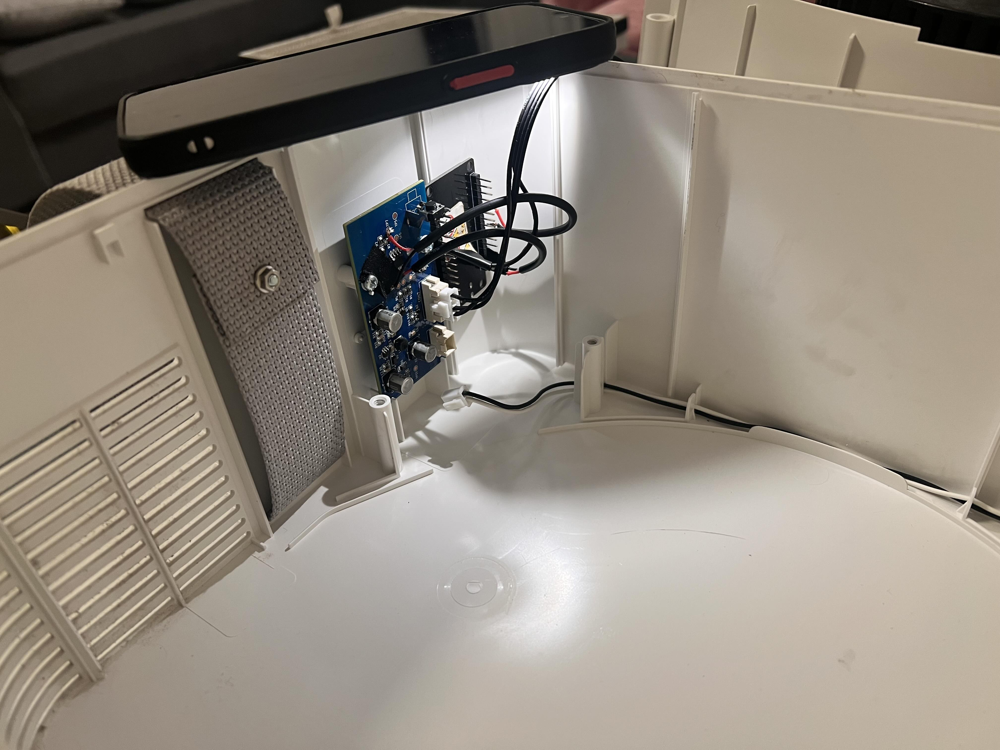
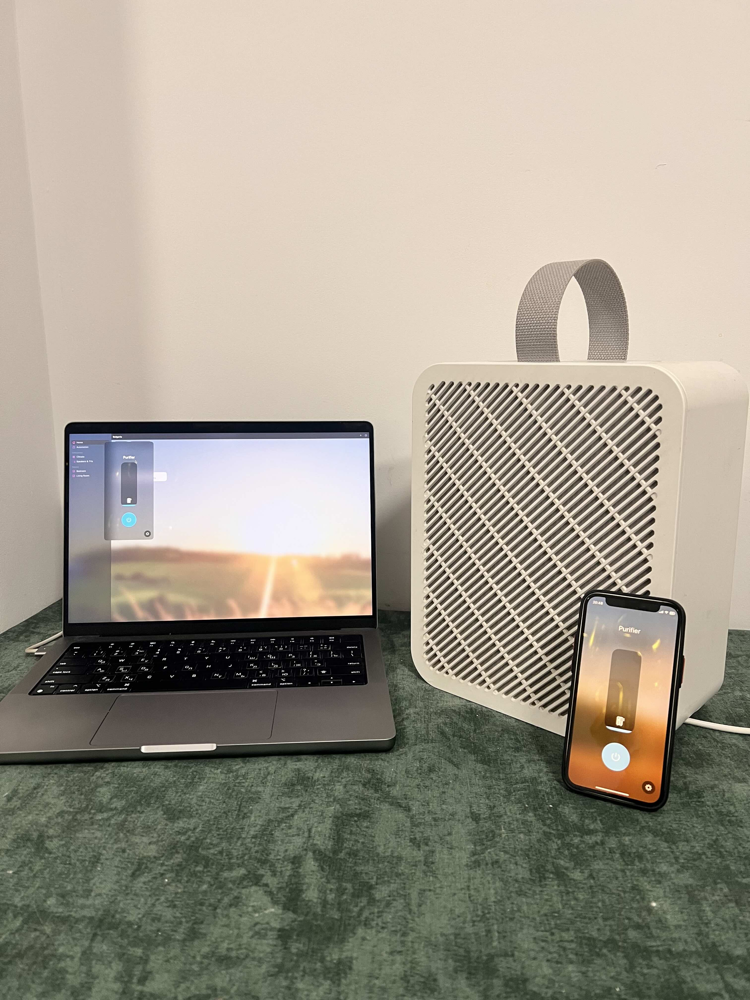
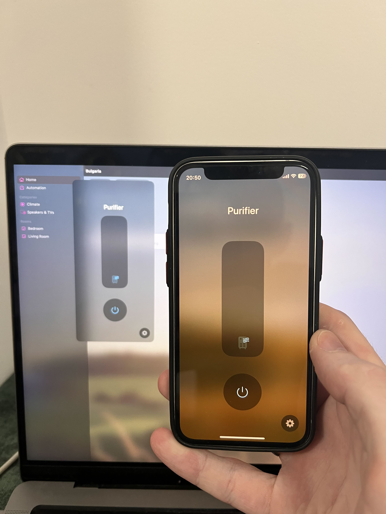
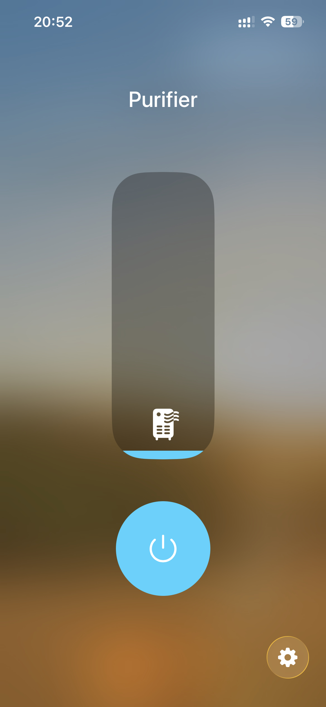

# HomeSpan IKEA UPPÅTVIND

Apple home-compatible ESP32 retrofit controller for the **IKEA UPPÅTVIND** air purifier.
This project doesn't replace the original control logic: a **HomeSpan-based ESP32** connects directly to the original board and adds
**Apple Home (HomeKit via the HomeSpan library)** support, while the original button and LED keep working.

The board simply attaches to the existing control PCB using four wires:

* Reads the LED signal (to detect current power/speed level)
* Simulates the button press (to toggle power levels)
* Controls the fan via PWM frequency

---

## ✨ Features

* Native **Apple Home** integration (via HomeSpan)
* **Reads the purifier’s LED signal** (PWM duty cycle) to detect active mode (Off / Low / Medium / High)
* **Simulates button press** for mode cycling (power & speed)
* **Controls fan speed** via PWM frequency output
* Automatically synchronizes state changes between:

    * Physical button presses
    * Home app commands
* **Temperature and humidity** in Apple Home from an optional DHT11 sensor (not shown in Home when it isn't connected)
* On-board LED heartbeat (blinks to indicate activity or running state)
* **Setup from the phone** — without Wi-Fi the purifier starts its own access point with a one-page setup:
  pairing QR code and code, Wi-Fi network list, firmware upload
* **OTA firmware updates** from the same setup page — no cable needed once the board is inside the purifier
* **Factory reset** by holding the purifier button for 5 seconds, confirmed by the purifier LED blinking
* No cloud dependency — the web page exists only in setup mode

---

## ⚙️ Hardware Setup

### Wiring Diagram

Below is the basic wiring setup between the ESP32 dev board and the purifier control board.

```
+----------------------------------+
|        IKEA UPPÅTVIND PCB        |
|                                  |
|  [SIGNAL_PIN] ----- TP7          |
|  [EMULATEPIN] -------- TP4       |
|  [PWMPIN] - WIRE Black to fan    |
|  [GND] ----------- TP2           |
|  [VIN] ----------- TP3           |
+----------------------------------+
             |
             v
+----------------------------------+
|            ESP32 Dev Board        |
|                                  |
|  SIGNAL_PIN   = GPIO 35 (Input)  |
|  EMULATEPIN   = GPIO 25 (Output) |
|  PWMPIN       = GPIO 18 (PWM Out)|
|  LED_PIN      = GPIO 2  (Status) |
|  DHT_PIN      = GPIO 15 (DHT11)  |
|  GND          = Common Ground    |
|  VIN          = +5v              |
+----------------------------------+
```

---

### Pin Summary

| Function              | ESP32 Pin | Direction | Description                              |
|-----------------------|-----------|-----------|------------------------------------------|
| **LED Signal Input**  | GPIO 35   | Input     | Reads LED PWM to determine current speed |
| **Button Emulation**  | GPIO 25   | Output    | Simulates a physical button press        |
| **Fan Control (PWM)** | GPIO 18   | Output    | Controls fan power by PWM frequency      |
| **Status LED**        | GPIO 2    | Output    | Indicates board is alive / operational   |
| **DHT11 Data**        | GPIO 15   | Input     | Temperature and humidity sensor (3V3)    |
| **Ground**            | GND       | Common    | Shared reference with purifier board     |
| **+5v**               | VIN       | Input     | Get power for ESP32 board                |

### Button

The main button the UPPÅTVIND is active-low switch. It's schematic is like:

```
               S1
              _|_
U1--R1--TP4--o   o--GND
         |
         |
       ESP32
```

### LED

The main LED (LED1) of the UPPÅTVIND has 4 states, off, and low, medium, and high brightnesses. The PWM is used to
control the brightness.

The LED has similar wiring, but instead of an output pin the ESP32 uses an input pin connected to TP7.
The ESP32 can then measure the pulse width to sense the LED brightness.

```
U1--TP7--LED1--GND
     |
     |
   ESP32
```

| UPPÅTVIND | ESP32   | Notes                                                      |
|-----------|---------|------------------------------------------------------------|
| TP2       | GND     |                                                            |
| TP3       | VIN     | +5V                                                        |
| TP4       | GPIO 25 | TP4 is between the button switch at S1 and the UPPÅTVIND   |
| TP7       | GPIO 35 | TP7 is between anode (positive) side of LED1 the UPPÅTVIND |




Board connections

- Power up ESP32 board: TP3 and TP2 (TP3 is +5V, TP2 is GND)
- Button imitate press: TP4
- LED check state: TP7

---

## 🧠 Behavior

* When the **physical button** on the purifier is pressed, the ESP32 detects the change in LED PWM signal and updates
  its internal state.
* When the **Home app** changes the purifier state (On/Off or speed), the ESP32:

    * The fan speed changes immediately. 3 seconds after the last change (so dragging the slider doesn't click the
      button on every step) it simulates as many presses as needed to bring the original board and its LED to the matching level:
      off, 1–33 % → level 1, 34–66 % → level 2, 67–100 % → level 3 (the button cycles off → 1 → 2 → 3 → off).
    * Adjusts the PWM output frequency to match the desired speed.
* LED signal analysis is based on **PWM high/low timing** to infer brightness and thus speed mode.
  A new level is accepted only after two consecutive matching samples, to filter glitches.
* The **on-board LED** (GPIO 2) blinks periodically to confirm operation or watchdog activity.

---

## 📦 Installation

1. **Clone the repository**

   ```bash
   git clone https://github.com/mrSerg/homespan-ikea-uppatvind.git
   cd homespan-ikea-uppatvind
   ```

2. **Open in Arduino IDE**

    * Install the **esp32 by Espressif** boards package, version **3.x** (tested with 3.3.8).
    * Install the [HomeSpan](https://github.com/HomeSpan/HomeSpan) library (tested with 2.1.8).
    * Install the **DHT sensor library** by Adafruit (tested with 1.4.7) together with its dependency
      **Adafruit Unified Sensor**.
      Everything else (web server, QR code generator, OTA) comes with the ESP32 core.
    * Select the correct board: **ESP32 Dev Module**.
    * Set **Tools → Partition Scheme → Minimal SPIFFS (1.9MB APP with OTA/190KB SPIFFS)** — HomeSpan doesn't fit the default
      1.2MB app partition, and OTA updates need two app slots.
    * Open `homespan-ikea-uppatvind.ino`.

3. **Flash the firmware**

    * Connect the ESP32 to your computer via USB.
    * Upload the sketch.
    * Open the serial monitor (115200 baud) to verify connection.

4. **Connect to Wi-Fi**

    * On first start (or after a reset) the purifier creates the Wi-Fi network **IKEA-Uppatvind**,
      password `uppatvind`.
    * Join it from your phone — the setup page opens automatically (or go to `http://192.168.4.1`).
    * The page shows the **pairing QR code and code** — take a screenshot or write it down
      (or press *Generate new code* first).
    * Choose your home network, enter its password and press *Save and connect*. The purifier reboots
      and joins your network; the setup access point is gone until the next reset.

   

5. **Pair with Apple Home**

    * In the **Apple Home app** tap *Add Accessory → More options*, pick **Purifier Uppatvind**
      and enter the pairing code from the setup page, or scan the saved QR code (e.g. shown on another screen).
    * After setup, the device will automatically reconnect after reboot.

### Firmware update (OTA)

Reset the purifier (see below) to start the setup access point, open the setup page and use **Firmware update** at the
bottom. Upload the `.bin` file from **Sketch → Export Compiled Binary** in Arduino IDE (the file without `bootloader`,
`partitions` or `merged` in its name). Uploading takes about 20–40 seconds; keep the page open until it shows
*Update installed*. Wi-Fi settings and pairing are erased by the reset, so set up Wi-Fi and add the purifier to Home again
after the update.

The first flash must be done over USB with the partition scheme above — the default scheme has no room for OTA.

### Reset

Hold the purifier button for **5 seconds** and release it. The fan stops and the purifier LED cycles through the levels
for about 5 seconds — that means the reset was accepted. Wi-Fi settings and HomeKit pairing are erased and the setup
access point starts again. Remove the old purifier from the Home app before adding it again.

---

## ⚡ How It Works

| Component       | Function                                                              |
|-----------------|-----------------------------------------------------------------------|
| **LED Signal**  | Provides PWM waveform representing purifier speed (OFF/LOW/MED/HIGH). |
| **PWM Control** | ESP32 outputs PWM with frequency mapping to speed levels (75–320 Hz). |
| **Button Sim.** | Digital pulse (~100 ms) emulates the purifier’s tactile button press. |
| **Watchdog**    | HomeSpan watchdog reboots the ESP32 if the firmware hangs for 5 s.    |
| **HomeSpan**    | Handles HomeKit (Apple Home) pairing and state synchronization.       |

### Power-up on the purifier supply

The purifier's 5 V rail (TP3) can't deliver the current spike of the first Wi-Fi start right after power-on: the ESP32
browns out inside `WiFi.begin()` and stays dead without rebooting. Delaying Wi-Fi, lowering the CPU clock to 80 MHz or
the TX power to 8.5 dBm did not help. What works is a two-stage boot:

* On a power-on reset (`ESP_RST_POWERON`) the firmware only switches the radio to station mode, waits 1 s and calls
  `ESP.restart()`. HomeKit and Wi-Fi start on the following software-reset boot, which the supply survives.
* The watchdog is enabled first thing in `setup()` with a 5 s timeout and is never disabled (also not during reset or
  OTA upload) — a longer timeout misses the window to reboot before the supply sags.
* Wi-Fi TX power is limited to 15 dBm to lower the peak current.
* The factory-reset hold only counts after the button line has been seen HIGH since boot, so a line held LOW during
  power-up isn't mistaken for a 5-second press.

The real fix is hardware: a 470–1000 µF capacitor on the ESP32 VIN. Don't remove the two-stage boot without it.

When the device misbehaves only inside the purifier (no serial log there), a temporary build that writes the reset
reason and the last reached stage to NVS on every boot, read back over USB afterwards, is what found this.

---

## 📷 Media







---

## Demo videos

- [Demo Video 1](assets/IMG_7655-1.mp4)
- [Demo Video 2](assets/IMG_7655-2.mp4)
- [Demo Video 3 (yes, accent is bad, i know)](assets/IMG_7659.mp4)

---

## 🧬 Known Limitations

* Apple Home can't pass Wi-Fi credentials to the purifier (that needs Apple's MFi-only WAC), so Wi-Fi is set up via the access point first.
* The physical button only gives four discrete levels (OFF / 1 / 2 / 3); from Apple Home the speed is set smoothly (0–100%).
* PWM frequency mapping may vary slightly depending on fan hardware tolerance.
* Requires shared GND with purifier control board.
* The purifier supply is too weak for a cold Wi-Fi start; the firmware works around it with an extra reboot after power-on (see *Power-up on the purifier supply*).

---

## 🪪 License

This project is licensed under the [MIT License](LICENSE).

---

## 💡 Credits

Inspired by

[jonathonlui/esphome-ikea-uppatvind](https://github.com/jonathonlui/esphome-ikea-uppatvind)

[maxmacstn/ESP32-IKEA-UPPATVIND](https://github.com/maxmacstn/ESP32-IKEA-UPPATVIND)

[horvathgergo/esp8266-for-uppatvind](https://github.com/horvathgergo/esp8266-for-uppatvind)

Adapted and extended with **HomeSpan (HomeKit) integration**

---

## Tags for search

- IKEA apple home
- Uppatvind smart
- Uppatvind apple
- Purifier ikea apple home
- Add Uppatvind to apple home
- Uppatvind Apple homekit